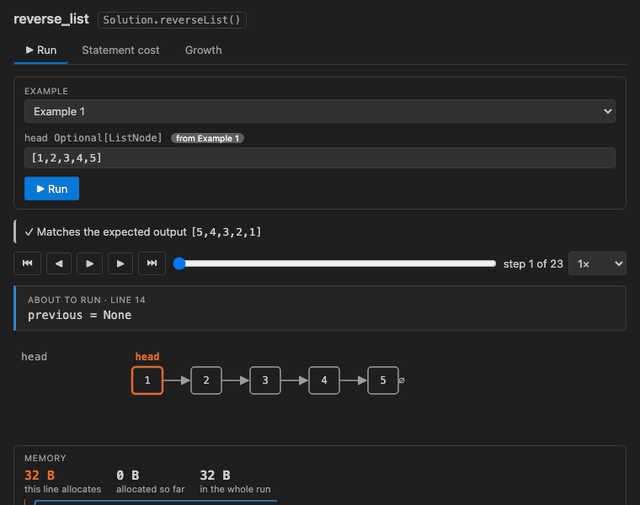
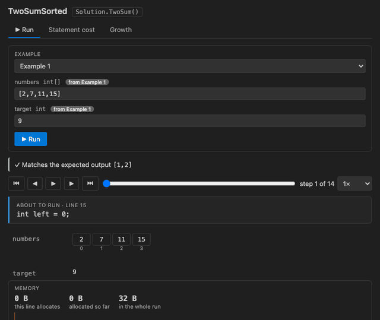
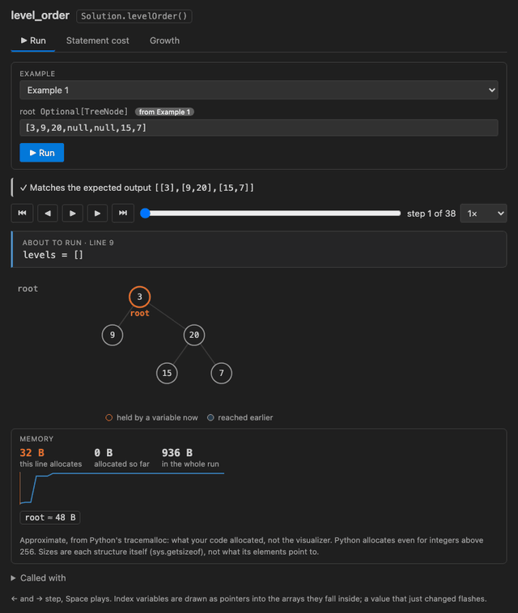
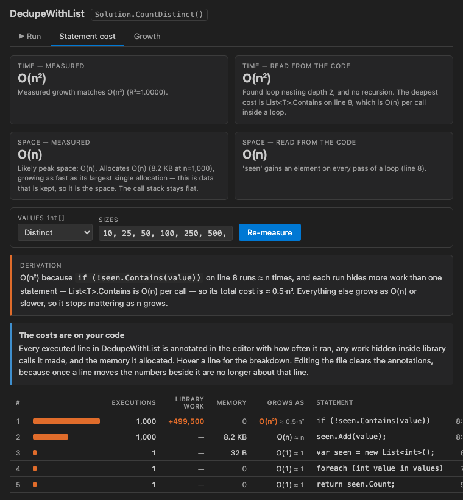

# DSA Playback — Algorithm Visualizer & Big-O Explainer

Watch your data-structures-and-algorithms code run, one step at a time — and see why it
has the complexity it has. For C# and Python, written the way LeetCode writes it.

- **Runs on your machine.** Nothing to set up for C#: the engine is inside the
  extension. For Python, the Python you already have is used (3.9 or later).
- **No sign-in.** No account, and nothing is collected about you.
- **Your code never leaves your computer** — unless you turn on the optional AI
  explanation, which sends a step to your own Copilot when you ask.
- **Explains *why* a solution is O(n²), line by line** — *"When the input doubles, this
  takes about four times as long, because line 10 runs once for every pair of items."*



## Watch it run

Open a C# or Python solution. Above every method you can run there are two buttons:

- **▶ Visualize** — plays your code step by step, with your data drawn and moving:
  - arrays with `i`, `j`, `left`, `right`, `mid`… as pointers that slide, and swapped
    values that trade places
  - linked lists whose arrows bend as you rewire them — `prev`, `curr` and `next` label
    the nodes they point at
  - trees, with the nodes your recursion is working on marked
  - graphs, with visited nodes and the BFS queue
  - hash maps and sets whose entries animate in and out; stacks, queues and heaps
  - the call stack, and a recursion tree showing what every call returned
  - memory: what each line allocates, and the total as the run goes

  The current line lights up in the editor. ← and → step, Space plays, and the speed
  goes from 0.25× to 4×.
- **Complexity** — runs your code on bigger and bigger inputs and explains how its time
  and memory grow, line by line.





## The input comes from your code

Paste LeetCode's example as a comment above your solution:

```csharp
// Example 1:
// Input: nums = [2,7,11,15], target = 9
// Output: [0,1]
```

In Python, the same comment with `#`:

```python
# Input: nums = [2,7,11,15], target = 9
# Output: [0,1]
```

**▶ Visualize** runs exactly that input and checks your answer against the expected
output — *✓ Matches* or *✗ Expected [0,1], got [1,0]*. A call with values written out
works too, in `Main` or under `if __name__ == "__main__":`:

```csharp
int[] nums = { 2, 7, 11, 15 };
new Solution().TwoSum(nums, 9);
```

```python
if __name__ == "__main__":
    print(Solution().twoSum([2, 7, 11, 15], 9))
```

Several examples? Pick one from the list, or press **Run all examples** to check every
one at once — each gets a ✓ or ✗, and clicking it plays that example. No example?
Values are generated for you at a size you choose. Want something else? Type it in LeetCode's format —
`[2,7,11,15]`, `"abcabcbb"`, `[[1,0],[0,1]]`, or a tree as `[3,9,20,null,null,15,7]` —
and press Enter.

## Why it's O(n²), not just that it is




**Complexity** shows:

- the answer in plain words first — *"When the input doubles, this takes about four
  times as long"* — then the notation
- how often each line ran and the memory it allocated, written beside the line
- the line that sets the method's class, and how many times it runs (*≈ 0.5·n² times*)
- work hidden inside library calls — `List.Contains` in C#, or `x in some_list` in
  Python, inside a loop is O(n²) even though every line looks O(1)
- memory: total allocated, the largest single allocation, and how deep recursion goes
- a reading of the code alongside the measurement, with any disagreement explained

## When something goes wrong

- Your code throws: *"Your code threw IndexOutOfRangeException at line 12"* — the run
  plays up to that line, and **Show line** takes you there.
- An endless loop or a missing base case is stopped and explained, never left hanging.
- A typed value that cannot be read is marked under its own box, with the position.
- A method taking a type that cannot be generated — a `double`, a `List<string>` —
  runs on the values in its example. Without an example, it says to add one.
- The visualizer itself fails: **Report a Problem** opens a GitHub issue filled in with
  the versions and the recent log, for you to read before sending. Your code is never
  included.

## Explain this step (optional, off by default)

Turn on **DSA Playback: Explain With AI** (`dsaPlayback.explainWithAI`) to get an
**✨ Explain this step** button in the run view, answered by your own GitHub Copilot in
plain English. **Turning it on sends your code to Copilot** — the code you are stepping
through, the current line and its variables — and only when you press the button. VS Code
asks your permission the first time. Needs VS Code 1.90 or later and a Copilot sign-in.
Everything else in DSA Playback stays on your machine.

## Questions

Ask in [Discussions](https://github.com/CodeWrapper12/dsa-playback/discussions). If
DSA Playback helps you, a rating helps other students find it.

## Design problems

LRU Cache, Min Stack, Implement Trie: a class, and LeetCode's two-line example of the
calls to make on it.

```csharp
// Input
// ["LRUCache", "put", "put", "get"]
// [[2], [1, 1], [2, 2], [1]]
// Output
// [null, null, null, 1]
public class LRUCache { … }
```

**▶ Visualize** appears above the class. It creates the object, makes every call in
order, and checks the list of results against Output. The run view says which call is
running — *Call 4 of 10: get*. Type other calls in the same two-list format to try your
own. Complexity is not measured for design problems.

## Files from LeetCode

Solutions copied from LeetCode, or made by the LeetCode extension, run as they are —
no `using` lines to add, and `TreeNode` and `ListNode` are supplied when the file leaves
them commented out. If the problem's description is in the file, its examples are used.

## Get started

Open the Command Palette and run **Welcome: Open Walkthrough…**, then **Get started with
DSA Playback**. Three samples — two pointers, a tree BFS, and memoised dynamic
programming — open ready to run.

## Python

Python files work the same way, with the Python you already have (3.9 or later): the
interpreter selected in the Python extension, or `python3` on your path. Use LeetCode's
template — type hints like `nums: List[int]` tell the visualizer what to generate, and
`TreeNode`, `ListNode`, `List`, `Optional`, `deque` and `heapq` are there without an
import, as they are on LeetCode. Memory figures come from Python's `tracemalloc` and are
approximate.
